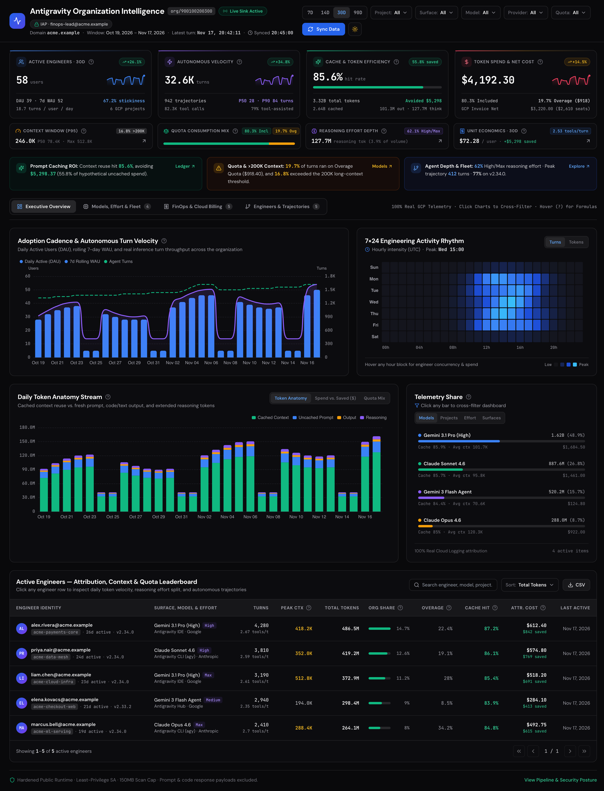
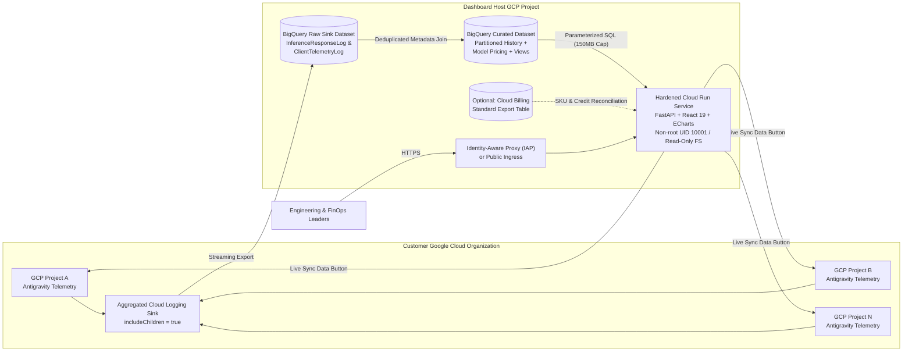
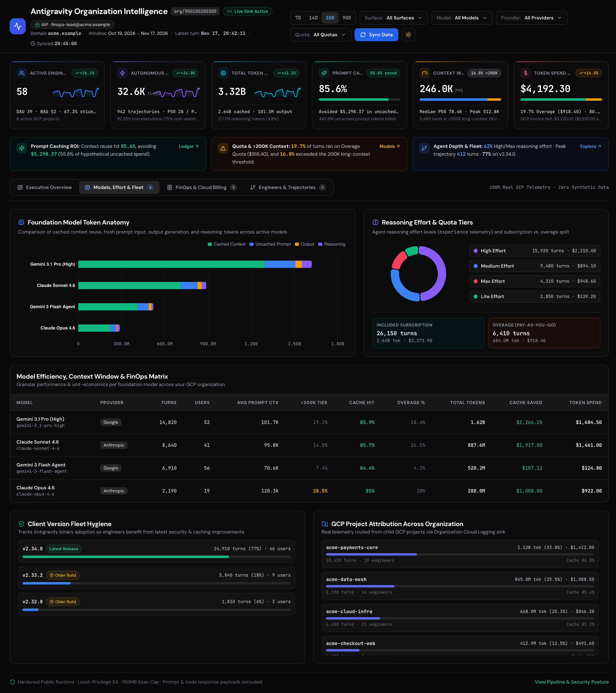
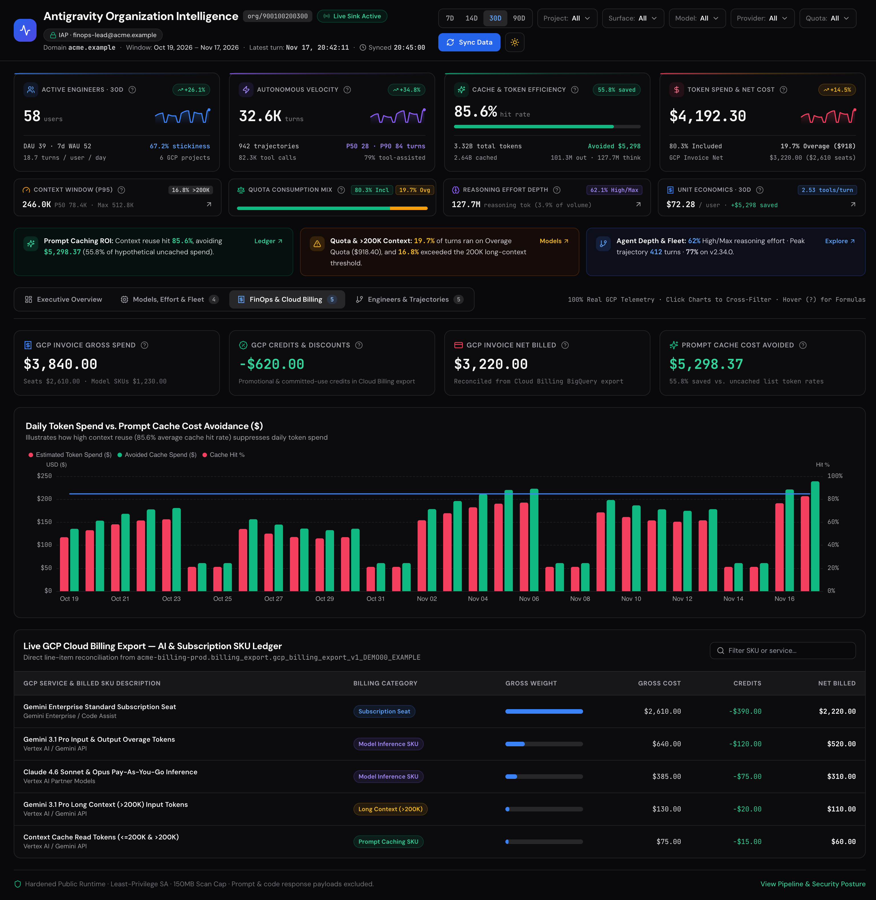
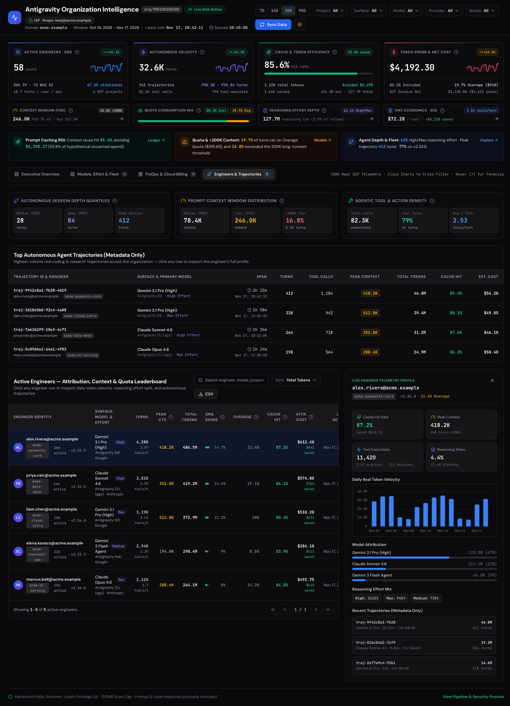

# Antigravity Organization Intelligence & FinOps Dashboard

[](LICENSE)
[](https://cloud.google.com/run)
[](#security--privacy-by-design)
[](#estimated-infrastructure-cost-tco--self-monitoring)

[](https://ssh.cloud.google.com/cloudshell/editor?cloudshell_git_repo=https%3A%2F%2Fgithub.com%2FMoshikoAvraham1402%2Fantigravity-org-dashboard.git&cloudshell_tutorial=docs%2Fcloudshell_tutorial.md)

An enterprise-grade, turnkey observability and FinOps web application for monitoring **Google Antigravity** (`businessaicode.googleapis.com`) adoption, active engineers, agentic trajectory depth, token economics, prompt cache ROI, and actual Cloud Billing invoices across an entire **Google Cloud Organization**.

Deployable into **your own Google Cloud environment** in under 5 minutes via **1-Click Google Cloud Shell**, a single CLI command (`./install.sh`), or **Terraform** — ensuring 100% data sovereignty inside your tenant.



---

## Why This Dashboard?

When rolling out Google Antigravity across engineering teams, platform and FinOps leaders need visibility across multiple GCP projects without exposing sensitive developer source code or prompt contents:

- **Adoption & Stickiness:** Who is actively using Antigravity (`DAU / WAU / MAU`), how sticky is daily usage (`DAU/MAU %`), and when does peak engineering velocity happen (`7x24 Timezone Heatmap`)?
- **Model & Effort Economics:** Which models (`Gemini 3.1 Pro`, `Gemini 3 Flash`, `Claude Opus`, `Claude Sonnet`, etc.) and effort modes (`High / Thinking`, `Medium`, `Lite`) drive token consumption and thinking-token overhead?
- **Prompt Cache ROI:** What percentage of prompt context is served from cache, and how much spend is saved (`Cache Hit %` & `USD Saved`)?
- **FinOps & Invoice Reconciliation:** How do token-based cost estimates compare against **actual Google Cloud Billing SKUs**, negotiated enterprise discounts, and `OVERAGE_QUOTA` vs. `REGULAR_QUOTA` consumption?
- **IDE Fleet Hygiene & Trajectory Depth:** Which Antigravity IDE versions are deployed across workstations, how deep are multi-step agentic coding sessions (`P50 / P90 / Peak Turns`), and how many autonomous tool calls execute per turn?

---

## Architecture



---

## Four Specialized Analytical Workspaces

| Workspace Tab | Key Metrics & Visualizations |
| :--- | :--- |
| **1. Executive Overview** | **Two-Tier Zero-Truncation Executive KPI Strip** (4 spacious Hero Cards: *Active Engineers & Stickiness*, *Autonomous Velocity*, *Cache & Token Efficiency*, *Token Spend & Net Cost* + 4 Interactive Diagnostic Tiles: *Context Window P95 / `>200K`*, *Quota Consumption Mix*, *Reasoning Effort Depth*, *Per-User Unit Economics*), **`(?)` Formula & Benchmark Tooltips** on every metric, **Interactive Click-to-Filter Dimensional Share** (Models, GCP Projects, Effort, Surfaces), **Daily Adoption & Multi-Lens Token/FinOps/Quota Streams**, **7x24 Activity Velocity Heatmap**, and **Engineer Leaderboard + CSV Export**. |
| **2. Models, Effort & Fleet** | **Interactive Foundation Model Token Anatomy** (click any model bar to cross-filter), **Reasoning Effort Donut & Quota Tier Cards** (`Lite`, `Medium`, `High`, `Max` + `Included` vs. `Overage`), **Full Model Efficiency & `>200K` Context FinOps Matrix** with formula tooltips, **Client Version Fleet Hygiene**, and **Clickable GCP Project Attribution Cards**. |
| **3. FinOps & Cloud Billing** | **Actual GCP Invoice Gross / Credits / Net Spend** (when `BILLING_EXPORT_TABLE` is linked), **Prompt Cache Cost Avoidance (`$ Saved` & `% Avoided`)** with formula popovers, **Daily Spend vs. Cache Savings Trend**, and **Searchable Live Cloud Billing AI & Subscription SKU Ledger**. |
| **4. Engineers & Trajectories** | **Autonomous Session Depth (`P50 / P90 / Peak`), Context Window, & Tool Execution Quantile Cards**, **Top Multi-Turn Agentic Coding Trajectories** (`trajectory_id` session explorer), and **Click-to-Inspect Engineer Profile Drawer** (individual 14-day timeline, model/effort split, clickable GCP project badges, and recent sessions). |

Plus a **Global GCP Project Filter**, removable **Active Cross-Filter Chips**, and a built-in **Sync Data** button in the top command bar that queries live Cloud Logging metadata across all accessible GCP projects on demand and appends new events directly into BigQuery without duplicates.

### Workspace Previews *(Shown with synthetic `acme.example` demo data)*

| Models, Reasoning Effort & Fleet Hygiene | FinOps & Live Cloud Billing SKU Ledger |
| :---: | :---: |
|  |  |

<details>
<summary><strong>Click to expand: Engineers, Autonomous Trajectories &amp; Live Profile Drawer</strong></summary>
<br/>



</details>

---

## Quickstart: Deploy in Under 5 Minutes

### Option 1: 1-Click Deployment in Google Cloud Shell (Zero Local Setup)

Click the button below to clone this repository directly inside **Google Cloud Shell** and launch an interactive step-by-step deployment walkthrough (`gcloud`, `bq`, and `python3` are pre-installed):

[](https://ssh.cloud.google.com/cloudshell/editor?cloudshell_git_repo=https%3A%2F%2Fgithub.com%2FMoshikoAvraham1402%2Fantigravity-org-dashboard.git&cloudshell_tutorial=docs%2Fcloudshell_tutorial.md)

### Option 2: CLI Installer from Your Terminal

#### Prerequisites
1. **Google Cloud SDK (`gcloud` & `bq`)** and **Python 3.10+** installed.
2. A **GCP Project** with Billing enabled to host BigQuery and Cloud Run.
3. Permissions:
   - Host project: `Owner` or `Editor` + `Project IAM Admin` (`roles/resourcemanager.projectIamAdmin`) + `Cloud Run Admin` (`roles/run.admin`).
   - Organization level *(recommended for org-wide telemetry)*: `Logs Configuration Writer` (`roles/logging.configWriter`) on your GCP Organization so the aggregated sink captures all child projects automatically.

#### Run the Turnkey Installer

```bash
git clone https://github.com/MoshikoAvraham1402/antigravity-org-dashboard.git
cd antigravity-org-dashboard

# Deploy with Zero-Trust IAP enabled (Recommended for Enterprise internal access)
./install.sh \
  --project YOUR_HOST_PROJECT_ID \
  --org YOUR_GCP_ORG_ID \
  --region us-central1 \
  --bq-location US \
  --timezone America/New_York \
  --access iap
```

Want to link your **BigQuery Cloud Billing Export** table for invoice SKU reconciliation, or deploy with **Public URL access**?

```bash
./install.sh \
  --project YOUR_HOST_PROJECT_ID \
  --org YOUR_GCP_ORG_ID \
  --region europe-west1 \
  --bq-location EU \
  --timezone Europe/London \
  --billing-table YOUR_BILLING_PROJ.billing_dataset.gcp_billing_export_v1_XXXXXX_XXXXXX_XXXXXX \
  --access public
```

### What `install.sh` Automates End-to-End:
1. Enables required GCP APIs (`run`, `cloudbuild`, `artifactregistry`, `bigquery`, `logging`, `cloudresourcemanager`, `iam`, `iap`).
2. Creates partitioned & clustered BigQuery datasets/tables (`antigravity_raw_logs`, `antigravity_monitoring`), seeds reference model token pricing (`model_pricing_rates`), maps org project numbers (`project_directory`), and deploys analytical views (`v_antigravity_events`, `v_daily_org_metrics`).
3. Provisions an aggregated **Organization Cloud Logging Sink** (`includeChildren=true`) with dataset-scoped BigQuery `WRITER` IAM (automatically falls back to a project sink if you lack org-level permissions).
4. Backfills the last **30 days** of historical Antigravity metadata from Cloud Logging across accessible projects.
5. Builds and deploys the multi-stage non-root container (`Dockerfile`) to **Cloud Run**.
6. Hardens runtime security: binds a dedicated least-privilege service account (`antigravity-dashboard-sa`), scopes BigQuery permissions strictly to the two dashboard datasets, caps scaling (`maxInstances=5`), and configures IAP or public ingress.

---

## Alternative Deployment: Terraform (Infrastructure-as-Code)

For platform engineering teams managing GCP via Terraform, a complete module is provided in [`terraform/`](terraform/):

```bash
# 1. Build & push the container image once via Cloud Build
gcloud builds submit --tag us-central1-docker.pkg.dev/YOUR_PROJECT_ID/cloud-run-source-deploy/antigravity-usage-dashboard:latest

# 2. Configure & apply Terraform
cd terraform
cp terraform.tfvars.example terraform.tfvars
# Edit terraform.tfvars with your project_id, org_id, and container_image

terraform init
terraform plan
terraform apply

# 3. Seed reference pricing table & analytical views
cd ..
python3 scripts/bootstrap_bigquery.py --project YOUR_PROJECT_ID --location US
```

For automated GitOps / CI/CD pipelines, use [`cloudbuild.yaml`](cloudbuild.yaml) with a GitHub Cloud Build Trigger.

---

## Configuration Reference

All backend settings in [`backend/main.py`](backend/main.py) are 100% environment-variable driven (zero hardcoded project or organization identifiers):

| Environment Variable | Required | Default | Description |
| :--- | :---: | :--- | :--- |
| `GCP_PROJECT_ID` | **Yes** | *(Auto-detected via ADC)* | Host GCP Project ID containing the BigQuery datasets. |
| `GCP_PROJECT_NUMBER` | If IAP | `""` | Numeric Project Number used to verify signed IAP JWT audiences. |
| `GCP_REGION` | No | `us-central1` | Cloud Run deployment region. |
| `GCP_ORG_ID` | No | `""` | Google Cloud Organization ID (displayed in UI & sink setup guide). |
| `GCP_ORG_DOMAIN` | No | `""` | Workspace domain displayed in header badges (e.g., `acme.com`). |
| `ORG_TIMEZONE` | No | `UTC` | IANA timezone (e.g., `America/New_York`, `Europe/London`) for the 7x24 heatmap. |
| `MONITORING_DATASET` | No | `antigravity_monitoring` | Curated BigQuery dataset storing views, pricing, and historical backfill. |
| `RAW_LOGS_DATASET` | No | `antigravity_raw_logs` | Raw BigQuery dataset targeted by the Cloud Logging sink. |
| `LOGGING_SINK_NAME` | No | `antigravity-org-bq-sink` | Name of the Cloud Logging sink. |
| `BILLING_EXPORT_TABLE` | No | `""` | Optional BigQuery Cloud Billing export FQN (`project.dataset.table`). When unset, FinOps SKU cards gracefully show setup instructions. |
| `ORG_PROJECTS` | No | *(Auto-discovered)* | Optional comma-separated project IDs for `Sync Data`. When blank, active accessible projects are discovered dynamically via Cloud Resource Manager API. |
| `REQUIRE_IAP_AUTH` | No | `false` | Set `true` behind Cloud Run IAP to enforce cryptographic ES256 JWT verification inside FastAPI. |
| `MAX_BYTES_BILLED` | No | `157286400` (`150 MB`) | Hard per-query BigQuery bytes-billed safety ceiling. |

---

## Customizing Token Pricing Rates

Estimated API token valuations (`estimated_cost_usd`) and Prompt Cache savings (`cache_savings_usd`) are computed dynamically by joining telemetry events against `{PROJECT_ID}.antigravity_monitoring.model_pricing_rates`.

To customize rates for your negotiated enterprise pricing or add newly released models, run a standard SQL `MERGE` or `UPDATE` in BigQuery:

```sql
UPDATE `YOUR_PROJECT_ID.antigravity_monitoring.model_pricing_rates`
SET
  input_usd_per_1m = 1.25,
  cached_input_usd_per_1m = 0.125,
  output_usd_per_1m = 10.00,
  thinking_usd_per_1m = 10.00
WHERE model_id = 'gemini-3.1-pro-high';
```

Changes take effect immediately on the next dashboard refresh without redeploying Cloud Run.

---

## Security & Privacy-by-Design

1. **Zero Prompt or Source Code Exposure:** BigQuery views and the live `Sync Data` pipeline strictly extract token counts, model IDs, latency/session IDs, IDE versions, and user principals. Raw prompt text (`prompt`) and model code completions (`candidates`) are **never** queried, stored in curated tables, or returned by any API endpoint.
2. **100% Parameterized BigQuery SQL:** Every user-supplied filter (`days`, `project_id`, `model_id`, `email`) is validated via strict allowlists/regexes and bound via `bigquery.ScalarQueryParameter` — zero string interpolation of user input.
3. **Least-Privilege Runtime Identity:** Cloud Run executes as `antigravity-dashboard-sa` with dataset-scoped `READER` permissions (not broad project Editor roles) and runs inside a read-only container filesystem (`chmod a-w /app`) as unprivileged UID `10001:10001`.
4. **Built-in Abuse & Cost Guardrails:** Per-IP token-bucket rate limiting (`60 req/min` read, `3 syncs / 5 min`), `150 MB` `maximum_bytes_billed` per BigQuery query, `maxInstances=5` Cloud Run scaling cap, and strict `Content-Security-Policy` / `HSTS` / `X-Frame-Options: DENY` headers.

---

## Estimated Infrastructure Cost (TCO) & Self-Monitoring

Because the entire stack is **100% serverless and scale-to-zero** (`minInstances=0` on Cloud Run, **Direct Cloud Run IAP** with zero Load Balancer fixed fees, `$0` Cloud Logging sink routing fees, and day-partitioned BigQuery tables with a `30s` response cache + `150 MB` scan cap), hosting the dashboard itself costs **pennies to a few dollars per month**:

| Organization Size | Active Antigravity Engineers | Dashboard Refreshes / Mo | Net Monthly Cost *(With GCP Free Tier)* | Gross List Cost *(Shared Enterprise Billing Account)* |
| :--- | :---: | :---: | :---: | :---: |
| **Starter / Team** | 1 – 25 | ~300 | **\$0.00 / mo** | **~\$0.15 – \$0.40 / mo** |
| **Growth / Mid-Market** | 25 – 250 | ~1,200 | **\$0.00 – \$0.25 / mo** | **~\$1.20 – \$2.80 / mo** |
| **Enterprise** | 250 – 1,000 | ~3,500 | **~\$2.50 – \$5.50 / mo** | **~\$6.50 – \$14.50 / mo** |
| **Global Scale** | 1,000 – 5,000 | ~10,000 | **~\$15.00 – \$38.00 / mo** | **~\$25.00 – \$55.00 / mo** |

### How to Check Your Exact Dashboard Cost in GCP
Every resource and BigQuery SQL job provisioned by `install.sh` and `terraform/` is automatically stamped with the unified billing label **`datacloud=antigravity`**:
1. **Cloud Billing Console (No Code):** Open **Google Cloud Console → Billing → Reports**, filter by label **`datacloud = antigravity`**, and group by **SKU** or **Service** to see exact daily/monthly net costs.
2. **Instant SQL Self-Audit (`INFORMATION_SCHEMA`):** Run the copy-paste BigQuery query & storage cost audit queries in [**`docs/COST_ESTIMATION.md`**](docs/COST_ESTIMATION.md) to inspect exact bytes billed and storage GiB on Day 1 (even without a Billing Export table).

---

## Documentation

- [**Interactive Cloud Shell Tutorial (`docs/cloudshell_tutorial.md`)**](docs/cloudshell_tutorial.md) — Guided browser-based deployment walkthrough for Google Cloud Shell.
- [**Infrastructure Cost Estimation & Self-Monitoring Guide (`docs/COST_ESTIMATION.md`)**](docs/COST_ESTIMATION.md) — Detailed monthly TCO sizing by org tier, component pricing breakdown, budget alerts, and copy-paste SQL self-audit queries.
- [**Enterprise Installation & Upgrade Guide (`docs/INSTALLATION.md`)**](docs/INSTALLATION.md) — Detailed setup for Org/Folder/Project sinks, IAP Zero-Trust access, Cloud Billing linking, and cross-project `Sync Data` IAM.
- [**Architecture & Security Whitepaper (`docs/ARCHITECTURE_AND_SECURITY.md`)**](docs/ARCHITECTURE_AND_SECURITY.md) — Telemetry log schemas (`InferenceResponseLog` & `ClientTelemetryLog`), deduplication design, and defense-in-depth controls.
- [**Troubleshooting Guide (`docs/TROUBLESHOOTING.md`)**](docs/TROUBLESHOOTING.md) — Solutions for GCP Org Policies (`iam.allowedPolicyMemberDomains`), BigQuery dataset regions, Day-0 sink creation, and IAP permissions.

---

## Repository Structure

```text
├── install.sh                         # One-command turnkey customer GCP installer
├── Dockerfile                         # Multi-stage Vite build + hardened non-root Python runtime
├── cloudbuild.yaml                    # Automated CI/CD pipeline for Cloud Build triggers
├── requirements.txt                   # Pinned Python backend & provisioning dependencies
├── .env.example                       # Documented customer environment variables template
├── backend/
│   └── main.py                        # Multi-tenant configurable FastAPI + BigQuery service
├── frontend/                          # React 19 + Tailwind CSS + Apache ECharts SPA
│   └── src/
│       ├── App.jsx
│       └── components/                # Executive, Models/Fleet, FinOps, Trajectories & Drawer views
├── scripts/
│   ├── bootstrap_bigquery.py          # Idempotent dataset, table, pricing & SQL view bootstrapper
│   ├── setup_org_sink.sh              # Org / Folder / Project Cloud Logging -> BigQuery sink script
│   ├── backfill_real_logs.py          # Historical Cloud Logging metadata backfill (deduplicated)
│   ├── harden_cloud_run_security.py   # Runtime SA, dataset-scoped IAM & IAP/Public hardening
│   └── bigquery_views.sql             # Reference templated SQL views
├── terraform/                         # Declarative Terraform IaC module for enterprise platform teams
└── docs/                              # Cloud Shell tutorial, Installation, Security & UI previews
```

---

## Disclaimer & License

> **Disclaimer:** This is an open-source community solution accelerator and is **not** an officially supported Google product.

Licensed under the [Apache License 2.0](LICENSE).
